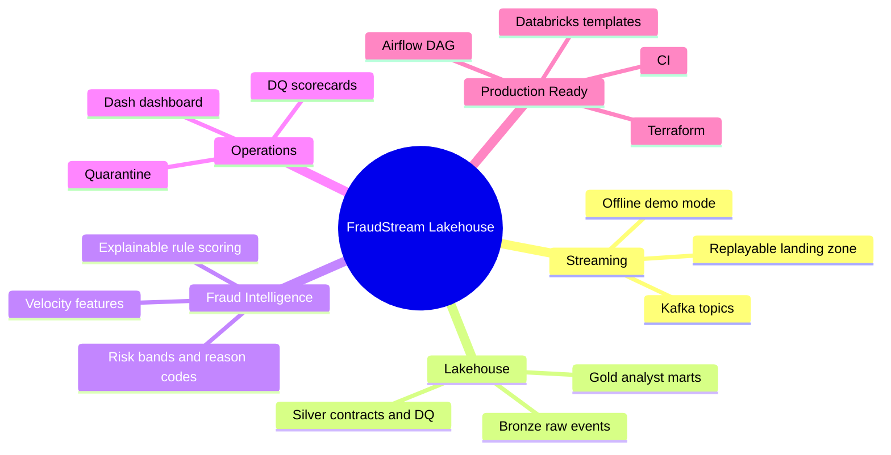
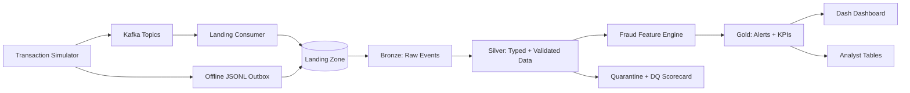
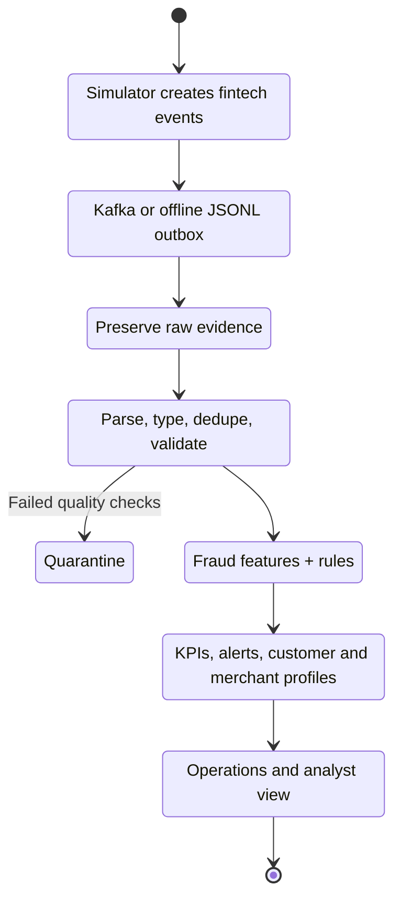
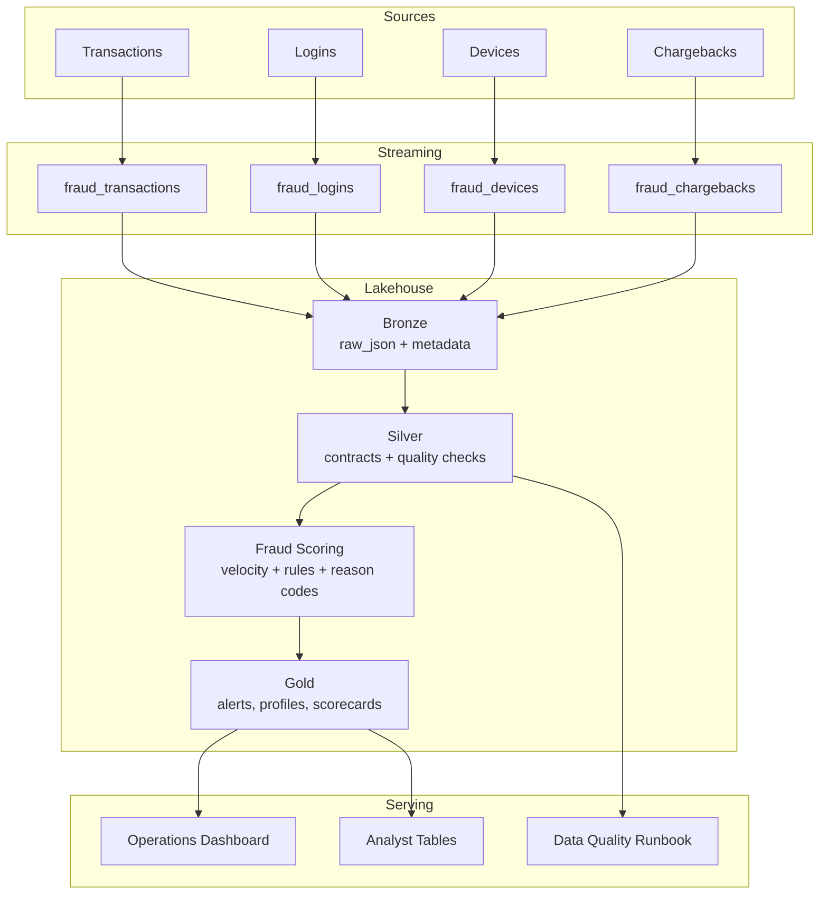
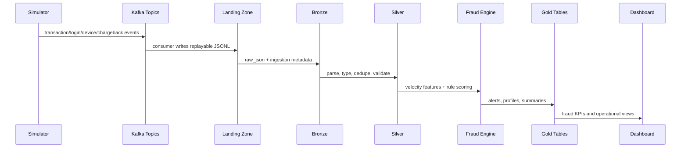
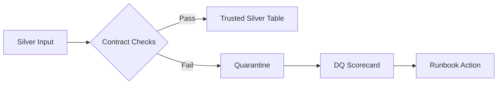
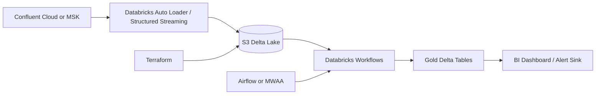

<h1 align="center">FraudStream Lakehouse</h1>

<p align="center">
  <b>Real-time fraud detection lakehouse built for data engineering portfolios, student labs, and production-style demos.</b>
</p>

<p align="center">
  
  
  
  
  
  
</p>

---

FraudStream Lakehouse simulates fintech transactions, streams events through Kafka, lands raw data, applies Bronze/Silver/Gold lakehouse processing, scores transactions with explainable fraud rules, quarantines bad records, and serves analyst-ready dashboards.

This repository is designed so students only fill environment variables when they move beyond local mode. The offline demo runs end to end without paid cloud services.

## Navigation

| Start Here | Deep Dive | Production Path |
|---|---|---|
| [Setup Guide](docs/setup.md) | [Architecture](docs/architecture.md) | [Cloud Deployment](docs/cloud_deployment.md) |
| [Requirements](docs/requirements.md) | [Data Contracts](docs/data_contracts.md) | [Runbook](docs/runbook.md) |
| [Dashboard Guide](docs/dashboard.md) | [Fraud Rules](docs/fraud_rules.md) | [Interview Story](docs/interview_story.md) |

## Executive Snapshot



## Architecture



## Pipeline Movie





## What This Project Demonstrates

- Real-time event generation for transactions, logins, devices, and chargebacks.
- Kafka-based streaming ingestion with an offline JSONL mode for easy teaching.
- Medallion architecture with Bronze, Silver, and Gold layers.
- Data contracts for every event type.
- Data quality checks with quarantine instead of silent drops.
- Explainable fraud scoring with risk scores, bands, and reason codes.
- Business-facing Gold tables for analysts and operations teams.
- Dash dashboard for visual monitoring.
- CI workflow, Terraform templates, Databricks notebooks, and Airflow DAG template.
- Public-repo-safe secret handling using `.env.example` only.

## System Capabilities

| Capability | What is implemented | Why it matters |
|---|---|---|
| Streaming ingestion | Kafka producer and consumer plus offline JSONL mode | Students can learn locally and still discuss real streaming design. |
| Medallion lakehouse | Bronze, Silver, Gold layers | Clear separation of raw, trusted, and serving data. |
| Data quality | Required fields, amount checks, country checks, quarantine | Bad data becomes observable instead of invisible. |
| Fraud intelligence | Rule scoring, velocity features, reason codes | Alerts are explainable for analysts and interviewers. |
| Serving layer | Plotly Dash dashboard over Gold tables | The project ends in business-facing outputs. |
| Production path | Terraform, Databricks, Airflow, CI | Shows how the demo can become a cloud architecture. |

## Quickstart: Offline Demo

This is the easiest path. It does not need Kafka, Docker, AWS, or Databricks.

```bash
cd FraudStream-Lakehouse
python -m venv .venv
source .venv/bin/activate
pip install -r requirements.txt
cp .env.example .env
bash scripts/run_offline_demo.sh
python -m fraudstream.dashboard.app
```

Open the dashboard:

```text
http://localhost:8060
```

## Quickstart: Kafka Local Stack

```bash
cp .env.example .env
docker compose up -d kafka minio minio-init postgres
bash scripts/init_kafka_topics.sh
python -m fraudstream.producers.transaction_simulator --event-rate 20 --duration 60 --fraud-rate 12
python -m fraudstream.consumers.landing_consumer --landing-root data/landing
bash scripts/run_local_pipeline.sh
python -m fraudstream.dashboard.app
```

## Environment Variables

Students should copy `.env.example` to `.env` and fill only what they need.

| Variable | Required For | Description |
|---|---|---|
| `KAFKA_BOOTSTRAP_SERVERS` | Kafka mode | Local or cloud Kafka broker address. |
| `MINIO_ENDPOINT` | Local object storage | MinIO endpoint for S3-compatible tests. |
| `S3_BUCKET` | Cloud mode | Bucket for Bronze, Silver, Gold, checkpoints, quarantine. |
| `AWS_ACCESS_KEY_ID` | AWS mode | Leave blank for local. Never commit real values. |
| `AWS_SECRET_ACCESS_KEY` | AWS mode | Leave blank for local. Never commit real values. |
| `DATABRICKS_HOST` | Databricks mode | Workspace URL. |
| `DATABRICKS_TOKEN` | Databricks mode | Personal access token or service principal secret. |
| `GOLD_DATA_PATH` | Dashboard | Path to Gold tables. Defaults to `data/gold`. |

## Repository Map

```text
FraudStream-Lakehouse/
├── fraudstream/
│   ├── producers/              # Synthetic fintech event generator
│   ├── consumers/              # Kafka landing consumer
│   ├── pipeline/
│   │   ├── bronze/             # Raw JSON ingestion
│   │   ├── silver/             # Parsing, contracts, data quality
│   │   ├── fraud/              # Fraud features and scoring rules
│   │   ├── gold/               # Business marts and alert tables
│   │   └── quality/            # Reusable quality checks
│   └── dashboard/              # Plotly Dash monitoring app
├── data_contracts/             # JSON schemas for each event stream
├── databricks/                 # Cloud notebook and workflow templates
├── airflow/                    # Orchestration template
├── infra/terraform/            # AWS S3 lakehouse foundation
├── docs/                       # Architecture, rules, quality, runbook
├── tests/                      # Unit, quality, and integration tests
└── scripts/                    # One-command local workflows
```

## Layer-by-Layer Design

```mermaid
flowchart LR
    subgraph Bronze["Bronze: Raw Evidence"]
      B1[raw_json]
      B2[topic]
      B3[batch_id]
      B4[processing_date]
    end

    subgraph Silver["Silver: Trusted Data"]
      S1[typed columns]
      S2[event_date]
      S3[deduplicated rows]
      S4[DQ results]
    end

    subgraph Gold["Gold: Business Outputs"]
      G1[fraud alerts]
      G2[daily summary]
      G3[customer risk 360]
      G4[merchant hotspots]
      G5[rule performance]
    end

    Bronze --> Silver --> Gold
```



## Data Flow



## Fraud Scoring

The scorer is intentionally explainable. Every high-risk row includes `risk_score`, `risk_band`, and `fraud_reason_codes`.

| Rule | Signal | Weight |
|---|---|---:|
| High amount | Transaction amount >= 600 | 20 |
| Country mismatch | IP/shipping country differs from billing country | 20 |
| New device high amount | New device and high transaction value | 20 |
| High velocity | Customer transaction count spike | 15 |
| Shared device | Many customers using one device | 10 |
| Failed login before purchase | Failed login activity before purchase | 10 |
| Card-not-present risk | Remote payment plus country mismatch | 15 |

## Gold Tables

| Table | Purpose |
|---|---|
| `gold_daily_fraud_summary` | Executive fraud KPIs by day. |
| `gold_realtime_alerts` | Highest-priority transactions for review. |
| `gold_customer_risk_profile` | Customer-level risk and activity profile. |
| `gold_merchant_risk_profile` | Merchant-level exposure and suspicious activity. |
| `gold_fraud_rule_performance` | Which rules are firing and how often. |
| `gold_data_quality_scorecard` | Data quality outcomes across streams. |

## Data Quality



Quality checks validate required IDs, timestamps, country codes, and non-negative amounts. Failed records are written to quarantine tables with check names and failure context.

## Cloud-Ready Path

Local mode is the student-friendly path. Cloud mode maps the same concepts to production services.



Included templates:

- `infra/terraform/` creates an encrypted private S3 lakehouse bucket.
- `databricks/notebooks/` shows Bronze, Silver, and Gold notebook structure.
- `databricks/jobs/fraudstream_lakehouse_job.json` defines a workflow shape.
- `airflow/dags/fraudstream_pipeline_dag.py` shows orchestration for local pipeline runs.

Install optional cloud dependencies only when needed:

```bash
pip install -r requirements-cloud.txt
```

## Testing

```bash
pytest -q
python -m compileall fraudstream tests
bash scripts/validate_project.sh
```

The integration test generates fraud events, runs all medallion layers, and verifies that Gold alert tables are produced.

## Public Repo Safety

This project is safe to publish because:

- Real secrets are ignored by `.gitignore`.
- `.env.example` contains placeholders and local demo values only.
- Generated data under `data/` is ignored.
- Terraform state files are ignored.
- CI includes basic secret-pattern checks.

Before pushing, run:

```bash
rg "github_pat_|AWS_SECRET|DATABRICKS_TOKEN|password" .
```

Only `.env.example` and documentation placeholders should appear.

## Documentation

- [Architecture](docs/architecture.md)
- [Requirements](docs/requirements.md)
- [Setup Guide](docs/setup.md)
- [Data Contracts](docs/data_contracts.md)
- [Fraud Rules](docs/fraud_rules.md)
- [Data Quality](docs/data_quality.md)
- [Dashboard Guide](docs/dashboard.md)
- [Cloud Deployment](docs/cloud_deployment.md)
- [Runbook](docs/runbook.md)
- [Interview Story](docs/interview_story.md)

## Portfolio Story

FraudStream Lakehouse is built to answer one real business question:

> Can a fintech team detect suspicious transactions quickly, explain why they were flagged, preserve auditability, and keep the pipeline reliable as data quality changes?

The answer is represented through streaming ingestion, medallion modeling, explainable scoring, quarantine-first quality design, and Gold tables that map directly to analyst and operations workflows.
