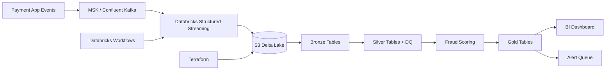

# Cloud Deployment Path

FraudStream is local-first, but the same architecture maps cleanly to a cloud lakehouse.

## Target Architecture



## Deployment Steps

1. Create cloud infrastructure:

```bash
cd infra/terraform
terraform init
terraform plan
terraform apply
```

2. Store secrets in Databricks secret scope:

```text
fraudstream/kafka_bootstrap_servers
```

3. Import notebooks from `databricks/notebooks/`.

4. Create a Databricks workflow from `databricks/jobs/fraudstream_lakehouse_job.json`.

5. Point `lakehouse_root` to the S3 bucket created by Terraform.

## Production Hardening Ideas

- Add schema registry compatibility checks.
- Replace rule-only scoring with a trained anomaly model.
- Send `gold_realtime_alerts` to Slack, PagerDuty, or a case management queue.
- Track data quality SLOs by source system.
- Add row-level lineage and data retention policies.

